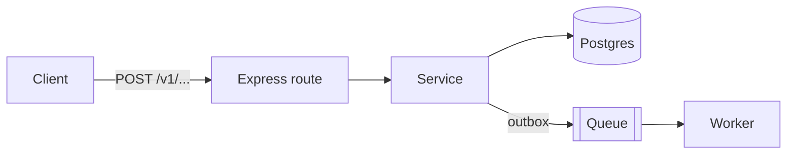

# Design note — <feature>

- **Author:** node-api-engineer · **Date:** YYYY-MM-DD · **Status:** draft | approved
- **Problem:** <1–3 sentences>
- **Non-goals:** <bullets>

## Diagram


## Contracts (Zod sketch)
```ts
export const CreateXInput = z.object({ ... });
export const XResponse = z.object({ ... });
```

## Data model diff
| Table | Change | Indexes | RLS |
|---|---|---|---|

## Checklist
| # | Item | Decision |
|---|---|---|
| 1 | Input/output sizes | |
| 2 | Concurrency | |
| 3 | CDN & edge | |
| 4 | Rate limiting | |
| 5 | Queues | |
| 6 | Schedules / cron | |
| 7 | Normalizer | |
| 8 | Validation | |
| 9 | Kafka-like features | |
| 10 | Media resolutions | |
| 11 | Multi-tenant | |
| 12 | Lifecycle | |
| 13 | Extracts / exports | |
| 14 | Agent loop | |
| 15 | Diagram | see above |

## Failure modes
| Failure | Detection (Sentry/alert) | Mitigation |
|---|---|---|

## Observability
- Spans: <name/op>
- Alerts: <condition → channel>

## Rollout
- Migration plan, feature flag, backfill, rollback.
