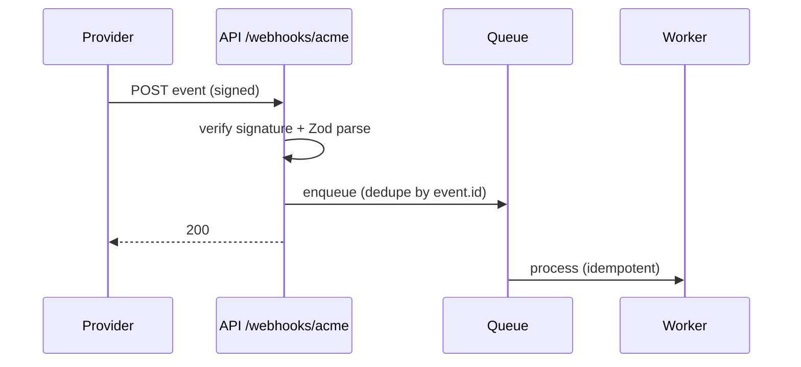

# Diagrams
Every design note has at least one diagram.

- **Mermaid** (inline in markdown, renders on GitHub):
  - `flowchart LR` for components/data flow
  - `sequenceDiagram` for request/webhook/job interactions
  - `stateDiagram-v2` for lifecycle
  - `erDiagram` for data model changes
- **Excalidraw**: for richer architecture sketches, save `docs/design-notes/<feature>.excalidraw` (JSON, committed) and export a `.svg` next to it for preview. Reference both from the note.

Rules: label edges with protocol/verb (`POST /v1/orders`, `enqueue order.created`), mark trust boundaries (browser / edge / api / db / third-party), show async hops distinctly (`-.->`).

